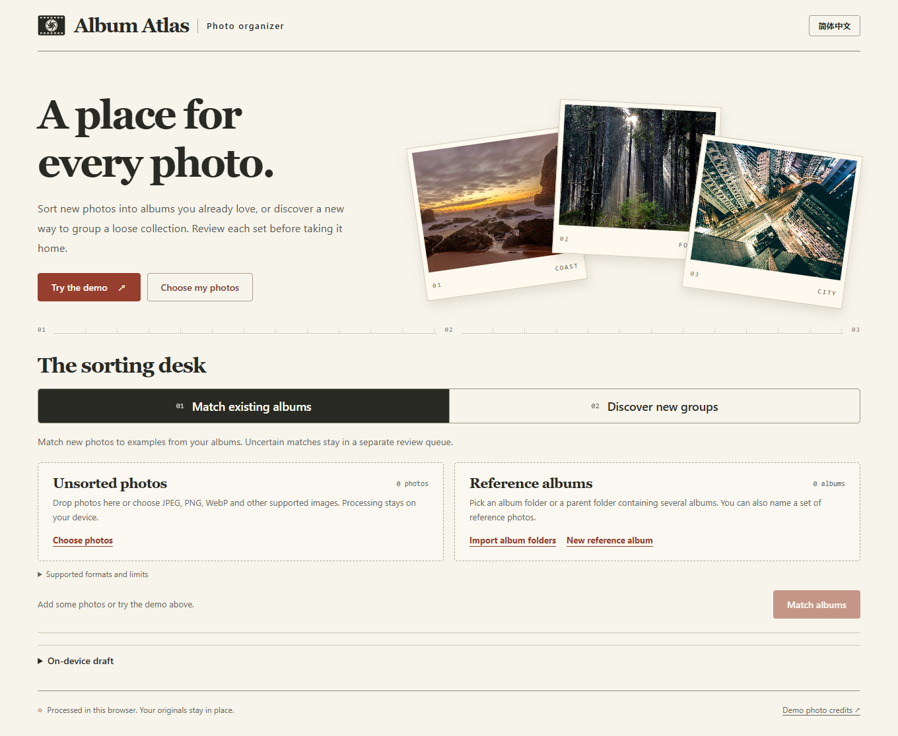
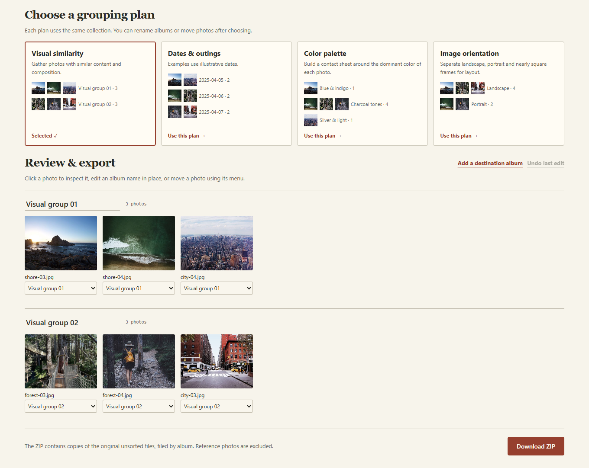

# Album Atlas · 相册罗盘

**把散图归进已有相册，或先比较几种分法，再决定照片该去哪。** 在浏览器里运行，无需账号、API Key 或安装软件。

[**打开相册罗盘**](https://sculiujiacheng.github.io/album-atlas/) · [English guide](#english-guide) · [模型实测](docs/model-evaluation.md) · [报告问题](https://github.com/SCUliujiacheng/album-atlas/issues)



### 同一张照片有好几个版本，导出哪一张？

如果一张照片看起来像另一张的局部，可以在 **裁剪对照** 中点击「查找裁剪候选」。打开候选，按矩形框核对原图，再以 100% 或 200% 放大看人脸和小字。点击已核看后，两份文件都会保留。可先用 [四张练习照片](docs/crop-practice.zip) 试一遍。[裁剪对照实验和失败例](docs/crop-review.md)

导入散图后，**副本复核**会并排列出文件名、像素尺寸、文件大小和匹配依据。重命名的相同文件会显示 SHA-256 一致；缩小、压缩过的版本可按画面结构和颜色列为候选。默认全部保留，可以一键跳过字节完全相同的多余副本，也可以逐张查看大图，决定跳过或恢复。选择会保存在本机草稿中，导出清单会记录跳过的文件。[与开源 ImageHash 的对照实测](docs/duplicate-evaluation.md)

### 我有几个整理好的相册，想把新照片放进去

1. 打开 **归入已有相册**，选择含多个相册子文件夹的上级目录。也可以手动创建相册，选几张参考照。每个相册最好有几张构图、明暗各不相同的代表照。
2. 添加待整理的照片，点击 **匹配参考相册**。工具按样片的视觉特征给出建议，两个相册太接近、或照片和样片差得太远时，会放进待确认区。
3. 点击缩略图看大图，逐张改分组，或把暂时拿不准的照片一起保留为单独相册。确认后导出 ZIP。原图字节、原始 EXIF 和画质都保留，同名文件会自动避让。

### 我只有一堆散图，还没想好怎么分

选择 **探索新分组**，添加照片。先看同一批照片按画面相似度、主色调、日期或横竖画幅会怎样分，再挑一套。日期和画幅能分出多组时才出现。每个方案都能预览实际照片，选中后可以为组改名、移图再导出。



### 使用细节

- **一次导入很多张，会卡住页面吗？** 相册罗盘 1.2 在支持的浏览器中，把视觉模型的加载与推理移到独立后台线程，文件仍在本机处理。后台线程不可用时会尝试在主线程运行同一模型。[响应速度实测与兼容性](docs/inference-responsiveness.md)
- **想先摸索一下？** 点击首页的「试用示例」。12 张有来源记录的摄影作品分成 6 张样片和 6 张待归档照片。演示日期用于展示不同的分法。[照片署名](assets/DEMO-CREDITS.md)
- **想分两次整理？** 主动选择保存本机草稿，下次在同一浏览器恢复。草稿会在此浏览器保存照片副本，清理网站数据或删除草稿即可移除。默认只在当前会话处理。
- **想断网使用？** 在线首次打开并让离线资源下载完成后，同一浏览器可以离线重新打开，视觉模型也在本地执行。也可以从源码在自己的电脑上运行。
- **导出什么？** ZIP 按确认后的相册名建立目录，并附原文件名与导出路径清单 `album-atlas.json`。只导出这次待整理的照片，参考照片不重复打包。原相册目录保持原样。
- **支持哪些文件？** JPEG、PNG 以及浏览器能解码的 WebP、AVIF、GIF、BMP。动图按静态画面提取特征，但导出完整原文件。HEIC 和相机 RAW 请先转成支持的格式。单文件最多 32 MiB，每个工作区最多 300 张、共 512 MiB。拍摄时间缺失时使用文件修改时间。

### 模型如何判断

浏览器用随应用分发的 ImageNet 预训练 MobileNet 提取视觉向量，再与用户提供的样片比较。自动归档同时考虑最相近相册的得分，以及它领先第二名的幅度。图像中的人名、私下约定和「给客户甲的照片」这类主观类别通常无法单靠画面推断。多个相似相册可以试着增加更有代表性的样片，再检查待确认区。[实验方法与局限](docs/model-evaluation.md)

### 本地运行

需要 Node.js 22 或更新版本。运行应用本身无需安装 npm 依赖。

```sh
git clone https://github.com/SCUliujiacheng/album-atlas.git
cd album-atlas
npm start
```

在浏览器打开 [本机工作台](http://127.0.0.1:4173/)。

### English guide

**Possible crops.** Import unsorted photos and start the optional crop review. Compare the originals at full resolution, inspect the proposed rectangle, and keep both files as reviewed. The worker stops at the 61st candidate and shows at most 60 direct pairs. [Practice photos](docs/crop-practice.zip) · [Measured comparison with ImageHash](docs/crop-review.md)

**Album Atlas organizes photos privately in your browser.** Open the app, switch to **English**, and try the sample collection or choose your own images. There are two workflows.

- **Match existing albums.** Import a folder of reference albums, add new photos, and review suggested destinations. Uncertain matches stay in a separate queue. You can create a destination, move a photo, or set aside the whole queue.
- **Discover new groups.** Preview several arrangements of the same photos by visual similarity, color, dates, or orientation. Choose a plan, rename the groups, then export copies of the original files in a ZIP.

**Review duplicate copies in either workflow.** Compare photographs side by side, including dimensions, file sizes and exact-byte or visual evidence. You can skip extra identical copies together or decide individually about similar-looking versions. Restoring a copy brings back its album assignment. The ZIP manifest lists any skipped copies. [Duplicate benchmark and limitations](docs/duplicate-evaluation.md)

The app serves its model and libraries locally. Optional drafts store copies on your device. The included photographs are a walkthrough. For independently measured matching performance, coverage, and false assignments, see the [evaluation report](docs/model-evaluation.md).

### Verification

Version 1.2 runs learned image inference in a dedicated worker. The page continues to handle input while the model initializes or processes photos on a CPU-only device. See the [paired v1.1 / v1.2 responsiveness study](docs/inference-responsiveness.md) for timings, fallback behavior and reproduction commands.

```sh
npm ci
npm test
npm run check:offline
npx playwright install chromium
npm run test:browser
npm run test:crops
```

The browser suite exercises folder import, both sorting modes, manual correction, local drafts, offline inference and byte-for-byte export. After changing app assets, regenerate the offline cache manifest with `npm run build:offline`.

Original application code is [MIT licensed](LICENSE). The [model and runtime](THIRD_PARTY.md), [EXIF parser](vendor/exifr.LICENSE), [ZIP library](vendor/fflate.LICENSE), and [demo photography](assets/DEMO-CREDITS.md) retain their respective terms.
