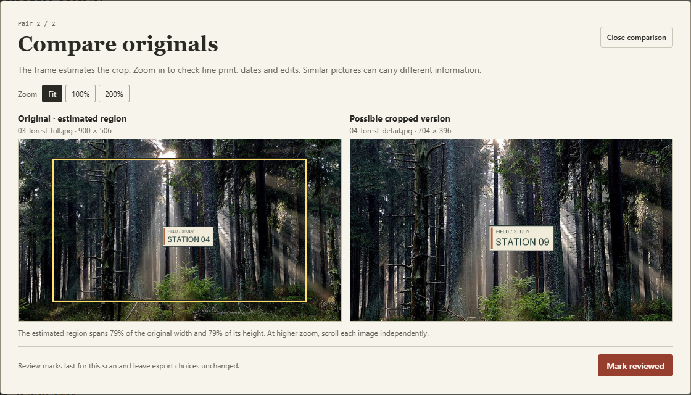

# Four-photo crop review · 四图裁剪练习

[Download the practice ZIP](crop-practice.zip) · [Open Album Atlas](https://sculiujiacheng.github.io/album-atlas/)

解压后，用「选择我的照片」导入四张 JPG，在「裁剪对照」点击「查找裁剪候选」。第一对是海岸照片的局部裁剪。第二对里，森林构图很像，但标牌上的站点编号不同。先看黄色估计框，再切换到 100% 读数字。标记「已核看」之后，四张图仍保留在本次导出里。

Unzip the pack and import the four JPEGs with **Choose my photos**. Click **Find possible crops**, then open each pair. The coastal photo has a genuine off-center crop. In the forest pair, inspect the framed region at **100%** and read the station number in both images. Compare **STATION 04** with **STATION 09** before deciding whether you need both versions. Marking a pair reviewed does not exclude either file from the ZIP.

These four derivatives are designed practice material. They are separate from the measured evaluation corpus. The station plaque is a fictional graphic added for this exercise. The app screenshot above uses only the public files in this pack.

## Credits

- **Coast.** Phil Evans (perthhealthcoach), *Rocky coast 1 (Unsplash)*. The pack keeps the bundled full JPEG and makes a new crop from it. [Wikimedia Commons source](https://commons.wikimedia.org/wiki/File:Rocky_coast_1_%28Unsplash%29.jpg)
- **Forest and screenshot.** Filip Varga (vargafilip123), *Sun’s rays in a dense forest*. Album Atlas added the practice plaque and generated the reframed variant from its bundled copy. [Wikimedia Commons source](https://commons.wikimedia.org/wiki/File:Sun%27s_rays_in_a_dense_forest_%28Unsplash%29.jpg)

Both source photographs carry the [CC0 1.0 dedication](https://creativecommons.org/publicdomain/zero/1.0/). The pack includes its instructions, credits and repository MIT notice in a UTF-8 text file. With Pillow 12.0.0, rebuild or check it from the repository root with `python scripts/make-crop-sample.py` or `python scripts/make-crop-sample.py --check`.
