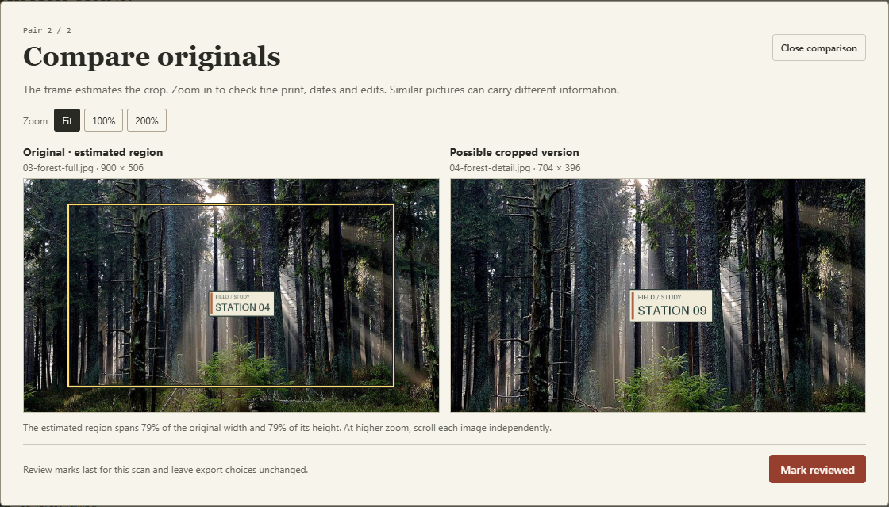

# Which photos might be crops of other photos?

Album Atlas can search a batch for a smaller composition inside another image. Start the optional crop scan after importing two or more unsorted photos. Open a pair to see an approximate rectangle on the original and inspect the full-resolution images. Zoom in on lettering, faces and other details before marking the pair reviewed. Both files stay in the export. [Four-photo practice pack](crop-practice.zip)



For a guided exercise, compare the two forest signs in the [bilingual walkthrough and image credits](crop-practice.md).

The scan uses a dedicated browser worker. Its search follows input order and stops when a 61st candidate establishes overflow. The review list retains at most 60 direct comparisons. The interface reports the limit, offers cancel, and discards results when the input changes. A dense batch can be split into smaller selections for closer inspection. The exact-byte bulk action uses SHA-256 evidence from the separate duplicate review.

## Same images, two crop matchers

We ran the browser implementation and the crop-resistant hash from the unmodified ImageHash 4.3.2 package on the same 1,584 encoded files and 7,128 labeled pairs. The comparison covers a whole-frame path plus an additional crop path in Atlas. A cropped match means a prompt for a person to inspect. For accuracy measurement the runner scores every labeled pair directly, independently of the 60-pair interface limit.

| Condition | Pairs | Atlas whole-frame only | Atlas with crop review | ImageHash native default | ImageHash stricter |
| --- | ---: | ---: | ---: | ---: | ---: |
| Fixed center, off-center, portrait and landscape crops | 576 | 0 | **360** | 297 | 39 |
| Crops with varied position, aspect, encoding and contrast | 576 | 0 | **330** | 298 | 39 |
| Identical files or JPEG re-encodes | 192 | 192 | 192 | 192 | 188 |
| Different original scenes | 4,560 | 0 | 0 | 98 | 0 |
| Crops paired with a similar but unrelated original | 1,152 | 0 | 0 | 60 | 1 |
| Distinct colorways or framed scenes | 48 | 0 | 0 | 35 | 24 |
| Cropped signs whose small lettering changed | 24 | 0 | **6 false prompts** | 12 | **1 false prompt** |

Across the 1,152 true crops, Atlas found 690 and the default ImageHash configuration found 595. On 96 crops retaining 69% of each side near one corner, ImageHash found 44 and Atlas found 17. The stricter ImageHash configuration also flagged fewer changed signs. The benchmark gives each family a fixed weight. A user's library can have an entirely different mix. [Results by transformation](crop-review-results.json)

All 690 accepted true crops identified the correct containing image. Their median rectangle intersection-over-union was 0.987, which measures overlap with the known crop geometry.

The signs explain why a close fit is useful evidence for a review yet insufficient grounds for deletion. A sign reading *PLATFORM 3: EAST* was changed to *PLATFORM 8: WEST*. Six same-background substitutions still produced matches. The 24 adversarial notices are intentionally separate designs even though they share most pixels. Their 6/24 result matters more to someone organizing signs than the 6/5,784 total across all negatives.

## What was fixed before the comparison

- **Atlas.** The candidate was selected on 96 separate reference/calibration photos and then frozen. It samples relative aspect ratios and positions in a 64 × 64 color image, verifies a promising region by finer alignment and checks local residuals. It uses the same correlation, color and tile cutoffs in this release. The actual worker decodes original Blobs with `createImageBitmap`. Chrome's JPEG rounding differs slightly from the earlier HTML-image prototype. The table uses production worker pixels and the ordinary import path's whole-frame fingerprints.
- **ImageHash.** The first configuration calls `crop_resistant_hash(image)` and `ImageMultiHash.matches` with the package defaults. The second requires two matching regions at no more than eight differing bits per regional hash. Either file may be the container, so we check both comparison directions. These are two named operating points of the library. [Tagged source](https://github.com/JohannesBuchner/imagehash/blob/e1941e96898e56422f7df678dd094c8d5b2b46db/imagehash/__init__.py) · [ImageHash 4.3.2](https://pypi.org/project/ImageHash/4.3.2/)
- **Test set.** The reservation includes 16 photographs from each of six outdoor scene categories. Their files are disjoint from the earlier 200-image experiment. Twelve crop transformations share each original, so the rows are correlated. The harder unrelated pairs are selected by the *old whole-frame signature* without consulting either new crop matcher. The sources are square scene photos. Phone portraits, scans of subtle document revisions and general photo-library accuracy need separate measurement. [Dataset](https://people.csail.mit.edu/torralba/code/spatialenvelope/) · [Reserved source filenames](../scripts/crop-eval-sources.json)

## What happens when the same composition occurs hundreds of times?

We assigned independent file IDs to 150 copies of the coastal original and 150 copies of its crop from the practice pack. The 300 inputs form 44,850 unordered pairs. On the measured Windows Chrome machine, the shipped scan stopped after examining 210 pairs. It confirmed at least 61 candidates and retained the first 60. Three end-to-end runs, including decoding and indexing, took a median 1.32 seconds. The largest observed main-page heartbeat gap was 22 ms.

Using the same already-encoded descriptors, the capped comparison took a median 49 ms. Exhaustive enumeration took 17.52 seconds and counted 22,500 cross-composition pairs. This is a deliberately dense workload with repeated image content. A batch with few matches can require all 44,850 comparisons. The worker can be canceled during either indexing or matching. Each image's extra typed descriptor buffers total 83,040 bytes, about 23.76 MiB for 300. Decoding, image Blobs, browser overhead and other app state require additional memory. Older mobile devices can behave differently. [Measurements](crop-cap-results.json) · [Reproduction script](../scripts/benchmark-crop-cap.mjs)

## Reproduce

Use Node.js 22+, Python and a fresh directory outside this checkout. The preparation script downloads the original photos. The repository distributes the sampling and transformation recipes.

```sh
npm ci
npx playwright install chromium
python -m pip install ImageHash==4.3.2 Pillow==12.0.0
python scripts/prepare-scene-eval.py ../scene-data
python scripts/prepare-crop-eval.py ../scene-data ../crop-fixtures
node scripts/score-crop-review.mjs ../crop-fixtures ../crop-browser-results.json
python scripts/compare-crop-imagehash.py ../crop-fixtures/fixtures ../crop-browser-results.json --out ../crop-summary.json --pairs-out ../crop-pairs.json
```

The recorded run used installed Chrome on Windows. Set `PLAYWRIGHT_CHANNEL=chrome` to select that channel. The JSON includes the browser, library versions, family counts and box localization. Different browser decoders can move a borderline match. Browser tests separately exercise the real user-facing scan: rotation-aware rectangles, zoom, dense results, cancellation, stale-input invalidation and preservation of original export bytes.
