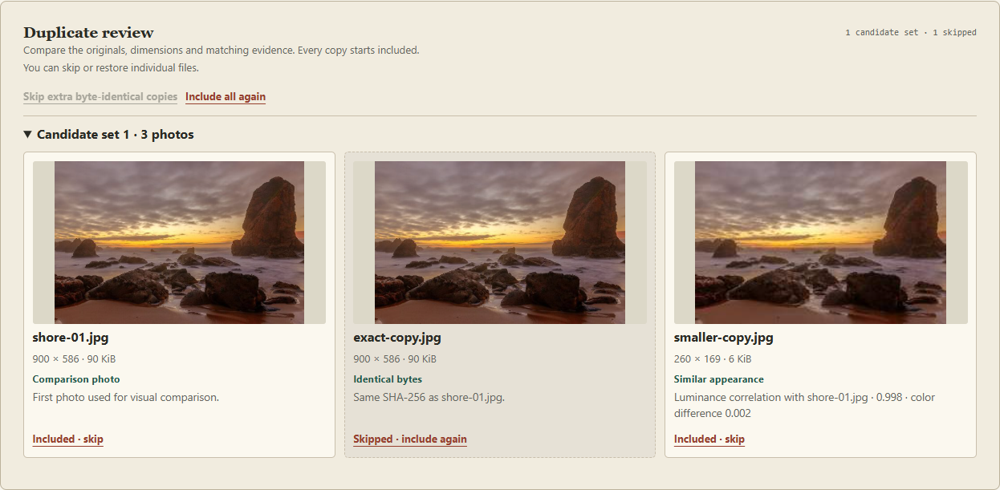

# Duplicate review benchmark

A duplicate alert asks a person to compare files. Album Atlas offers separate evidence for a byte-identical file and for a resized or re-encoded lookalike. Every file starts included. Only a user's skip decision can omit it from the ZIP.



The screenshot uses Nuno Miguel Valente's Ursa Beach photograph. [Photo credit and original source](../assets/DEMO-CREDITS.md)

## Same files, two matchers

We ran the released, unmodified Python package ImageHash 4.3.2 alongside Album Atlas's actual browser matcher. Both received the same encoded files and the same labeled pairs. The baseline was the package's 64-bit `imagehash.dhash` at Hamming distance ≤5. A second column reports exact hash matches to show how a stricter threshold changes the result. Distance ≤5 is our benchmark operating point. ImageHash also provides other hash functions with different trade-offs. [Pinned baseline source](https://github.com/JohannesBuchner/imagehash/blob/e1941e96898e56422f7df678dd094c8d5b2b46db/imagehash/__init__.py) · [ImageHash on PyPI](https://pypi.org/project/ImageHash/4.3.2/)

The external set used 48 outdoor photographs, twelve per category from the first hash-ordered test records for coast, forest, inner city and mountain. The generated files stayed outside the application. Each positive compares a photograph with a transformed copy of itself. The natural negative row compares every pair of distinct source files. The colorway row contains twelve separate pairs of generated designs with matching layouts but deliberately different colors. For this task those colorways should be kept separate. [Photo source and deterministic split](model-evaluation.md)

| Test family | Pairs | Album Atlas flagged | dHash ≤5 flagged | dHash =0 flagged |
| --- | ---: | ---: | ---: | ---: |
| Identical bytes under a different name | 48 | 48 | 48 | 48 |
| Half-size JPEG, quality 82 | 48 | 48 | 48 | 27 |
| JPEG re-encoded at quality 35 | 48 | 48 | 48 | 20 |
| Contrast ×1.18, JPEG quality 85 | 48 | 48 | 48 | 14 |
| Center crop retaining about 71% of width and height | 48 | 0 | 0 | 0 |
| Distinct outdoor photos | 1,128 | 0 | 0 | 0 |
| Distinct colorway controls | 12 | 0 | 12 | 12 |

**The measurable difference was twelve fewer false review prompts on the colorway controls.** Both matchers found all 192 identical, resized, recompressed and contrast-adjusted pairs at the ≤5 baseline threshold. Neither flagged an independent original, and neither recovered the substantial crops. The controlled colors expose an intended difference between a color-aware rule and grayscale dHash. They do not estimate the frequency of these collisions in a personal library.

On the 12 bundled demo photographs, both methods again found all 48 non-crop positives, missed all 12 crops and flagged none of 66 independent photo pairs at ≤5. The separate color controls are identical between runs and should only be counted once.

## What the browser compares

- A SHA-256 digest of the original file establishes byte identity. Renaming a file preserves this evidence. Re-encoding it generally changes the digest.
- A 32 × 32 white-backed preview is reduced to 16 × 16 luminance cells and 4 × 4 regional color samples. The recognizer compares normalized luminance correlation and average red–green / blue–green differences. It requires correlation ≥0.975, color difference ≤0.075, log aspect-ratio difference ≤0.035, mean luminance difference ≤0.18, and enough variation in both previews. Flat images are eligible for exact-byte matching.
- An exact copy points to the file with matching bytes. Visual candidates must match their set's anchor directly. Animated files can share a single displayed frame while differing elsewhere. Bursts, heavy crops, rotations and creative edits need human judgment.

## Reproduce

With Node.js 22+ and Python 3.11+ available, run from the repository root. The scripts generate fixtures in a temporary directory, invoke the shipped JavaScript in Chromium and compute ImageHash distances with the pinned Python package. The recorded run used Pillow 12.0.0, NumPy 2.3.5 and Chrome on Windows.

```sh
npm ci
npx playwright install chromium
python -m pip install ImageHash==4.3.2 Pillow==12.0.0 numpy==2.3.5
python scripts/benchmark-duplicates.py
python scripts/prepare-scene-eval.py ../atlas-scene-data
python scripts/benchmark-duplicates.py --scene-data ../atlas-scene-data --json ../atlas-scene-data/copy-pairs.json
```

Set `PLAYWRIGHT_CHANNEL=chrome` to use an installed Google Chrome. The optional JSON records the fixture names, labels, SHA/visual decision and raw dHash distance for every pair. [Fixture and baseline runner](../scripts/benchmark-duplicates.py) · [Browser runner](../scripts/benchmark-duplicates.mjs)
